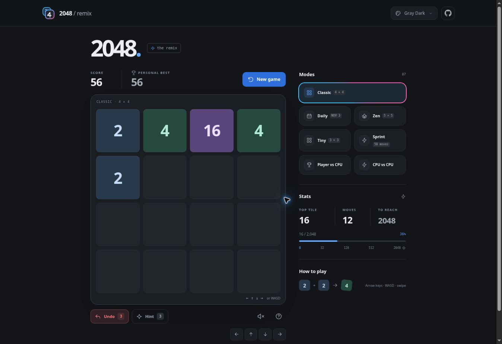
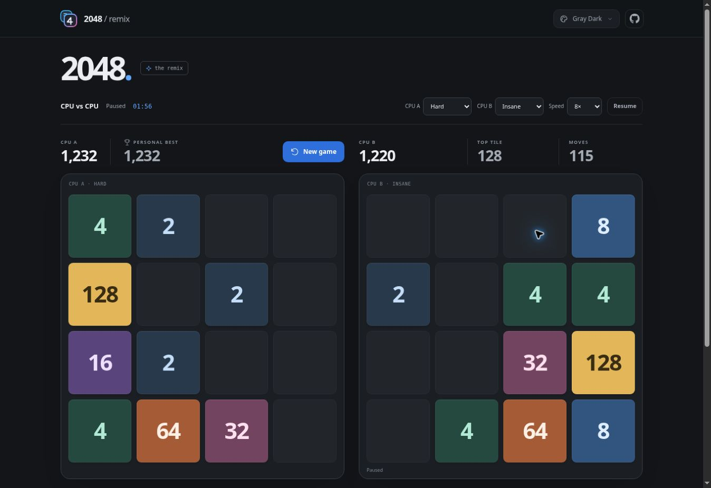

# 2048 Remix

**Dawson’s first GitHub repository. Still just for fun.**

This repo started in November 2024 as a small 2048 experiment—the first repository on the DawsonCodes account. It’s now a modern browser game with seven ways to play, local CPU opponents, and a few familiar themes.

[**Play 2048 Remix →**](https://dawsoncodes.github.io/2048-remix/)



## Game modes

| Mode | Rules |
| --- | --- |
| **Classic** | 4×4, target 2048, with the option to keep going. |
| **Daily** | A 4×4 challenge seeded by the UTC date. Restarting replays that day’s starting board and random sequence. |
| **Zen** | A roomy 5×5 board that continues past 2048. |
| **Tiny** | 3×3, target 512, with the option to keep going. |
| **Sprint** | Score as much as possible in 50 valid moves. |
| **Player vs CPU** | Each valid player move gives the CPU one turn. |
| **CPU vs CPU** | Watch two local CPUs play with independent difficulty settings. |

In both CPU modes, boards start from the same seed and use the same tile rules. A blocked board stops while the other continues. The match ends when both boards are blocked; the higher score wins, with top tile breaking score ties. CPU matches continue beyond 2048.

Pause/resume, elapsed time, and spectating speeds are built in. Hidden tabs automatically pause CPU matches. Saved matches retain both boards, settings, and elapsed active time.



## CPU difficulty

| Level | Decision making |
| --- | --- |
| **Easy** | Mixes legal exploratory moves with a simple evaluation. |
| **Normal** | Evaluates the immediate legal moves. |
| **Hard** | Searches further ahead within a bounded CPU budget. |
| **Insane** | Uses a deeper search and a larger CPU budget. |

CPU decisions use fixed board heuristics and bounded expectimax search. They run in a Web Worker, with a yielding fallback where workers are unavailable. Move choices leave the board and its random sequence untouched until a legal move is applied.

## Controls and assistance

| Action | Controls |
| --- | --- |
| Move | Arrow keys, WASD, swipe, or direction buttons |
| Undo | **U**, with **3 uses per run** |
| Hint | **H**, with **3 uses per run** |
| New game | **R** (asks before replacing a started run) |
| How to play | **?** or the help button |

Only a move that changes the board adds a new tile. Matching tiles merge once per move, and each merged tile’s value is added to the score.

Undo and hint counts survive reloads and mode switches. Undo does not refund either budget. In Player vs CPU, undo restores the paired player/CPU turn. CPU planning uses its own decision algorithm and does not consume player hints.

## Appearance and sound

- Gray Dark, Light, and MS Paint themes adapted from [AppWatch](https://github.com/DawsonCodes/AppWatch).
- AppWatch’s Octocat source link, plus a new matching game logo and favicon.
- A blue/pink rim that sweeps, slows to a stop, and pauses before repeating on hovered, keyboard-focused, and selected controls.
- A red Undo button with a short rewind animation.
- Smooth slides, merge pops, theme reveals, and reduced-motion support.
- Optional local WAV samples by Kenney for slides, merges, large tiles, undo, hints, and confirmations. Sound starts off.

All preferences and saves use `2048-remix:` storage keys. AppWatch and RPS-Robot were inspected as references; only this repository was edited.

## Run locally

Serve the repository with any static web server. There is no build step or dependency installation for the game.

For example, with Python:

```sh
python3 -m http.server 8000
```

Open `http://localhost:8000`.

With Node.js installed, run checks directly:

```sh
npm test
npm run check
```

Tests cover merging, scoring, invalid moves, win/loss states, assistance budgets, save migration, Daily replay, Tiny, Sprint, CPU legality, and randomized game invariants.

## Source layout

| File | Purpose |
| --- | --- |
| `index.html` | Accessible page, menus, controls, and dialogs |
| `engine.js` | Game rules, seeded randomness, assistance limits, hints, and save validation |
| `script.js` | Input, animation, saved runs, and CPU match coordination |
| `cpu-ai.js` | Fixed CPU evaluation and difficulty-dependent search |
| `cpu.js`, `cpu-worker.js` | Local worker transport and fallback |
| `audio.js`, `assets/audio/` | Sample playback and original CC0 audio license |
| `themes.css`, `theme-init.js` | AppWatch palette tokens and first-paint theme resolution |
| `styles.css` | Layout, tile colors, selection rims, and motion |
| `tests/` | Dependency-free Node tests |

## Hosting and privacy

GitHub Pages serves the static files at **[dawsoncodes.github.io/2048-remix/](https://dawsoncodes.github.io/2048-remix/)**. Gameplay and CPU decisions run in the visitor’s browser. There are no inference APIs, API keys, accounts, gameplay uploads, external fonts, CDN scripts, or per-game GitHub Actions jobs. No custom GitHub Actions workflow is added; publication uses the existing GitHub Pages setup.

Sound loads WAV files from this same site when enabled. Progress and preferences stay in this browser. Clearing site data clears the saves; blocked or full storage falls back to in-memory play. The latest Daily replaces the previous date’s saved Daily while retaining the mode’s personal best.

## Credits

The original [2048](https://github.com/gabrielecirulli/2048) was created by Gabriele Cirulli. This is an independent implementation.

Theme tokens, theme-picker behavior, and the Octocat icon come from Dawson’s AppWatch. Sound samples are from [Kenney’s Interface Sounds](https://kenney.nl/assets/interface-sounds), licensed CC0. See [THIRD_PARTY_NOTICES.md](THIRD_PARTY_NOTICES.md).

Mode research included compact boards in [sanskarIN/2048](https://github.com/sanskarIN/2048) and move-limited play in [ThomasFraserDev/2048](https://github.com/ThomasFraserDev/2048). The new mode implementations were written for this repo.

The original commits remain in the Git history.
